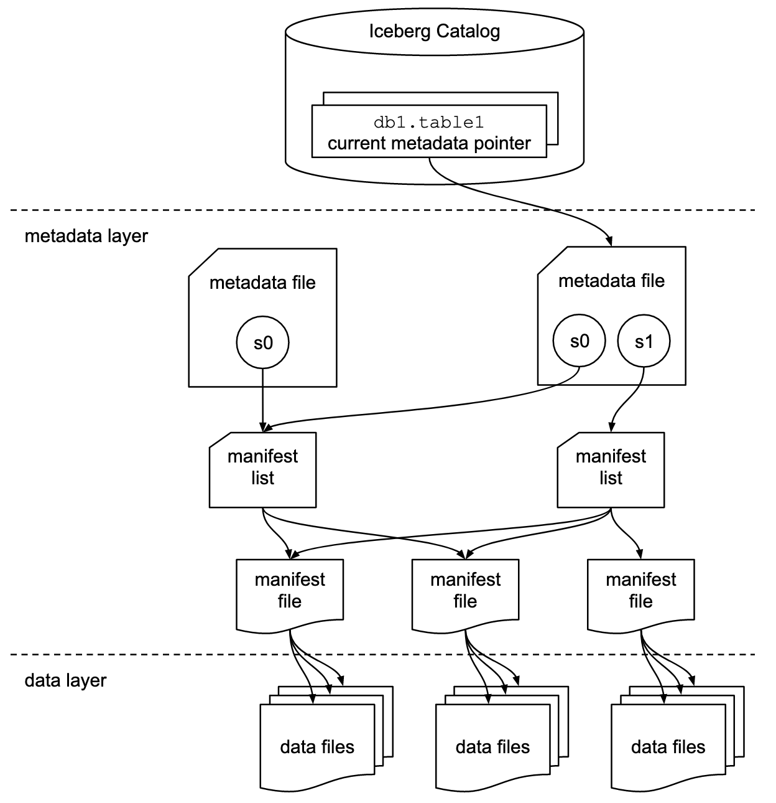

# Iceberg introduction

Apache Iceberg adds a table format on top of the parquet files, which brings transactions, history, and schema evolution. A catalog such as Apache Polaris sits above the tables: it tells every engine where they are, and decides who may read or write them. This module covers both, and what "data governance" means once the catalog is in place.

## Issues of Parquet file

Parquet gives us an efficient file format for analytical data, but a collection of Parquet files is not yet a complete table:

- Which files belong to the table?
- Which files represent the current version of the table?
- What was the table yesterday?
- What happens if two jobs write at the same time?
- How can we change the schema without rewriting all the data?
- How should the data be partitioned?
- How can we safely delete or update individual rows?
- Which files can be skipped when answering a query?

```text
s3://lakehouse/silver/users/
├── part-000.parquet
├── part-001.parquet
└── part-002.parquet
```

## Iceberg architecture

An Iceberg table consists of **data files plus metadata files**.

A simplified table might look like:

```text
s3://lakehouse/silver/users/
│
├── metadata/                             # tells Iceberg what the table is
│   ├── 00000-<uuid>.metadata.json
│   ├── snap-<id>-<uuid>.avro
│   └── <uuid>-m0.avro
│
└── data/                                 # contains the actual rows
    ├── 00000-<uuid>.parquet
    ├── 00001-<uuid>.parquet
    └── 00002-<uuid>.parquet
```

Iceberg tracks individual data files rather than relying on a directory structure to define the contents of the table.

## The metadata hierarchy



Iceberg metadata forms a chain:

```text
Table metadata
      │
      ▼
  Snapshot
      │
      ▼
Manifest list
      │
      ▼
  Manifests
      │
      ▼
 Data files
      │
      ▼
   Parquet
```

Each layer has a different responsibility.

### Table metadata

The table metadata describes the table itself.

It contains information such as:

- table schema
- partition specification
- table properties
- snapshots
- current snapshot

Conceptually:

```text
orders
├── schema
│   ├── order_id
│   ├── user_id
│   ├── ordered_at
│   └── amount
│
├── partition specification
│
└── current snapshot
       ↓
```

### Snapshot

A snapshot represents one complete state of the table.

For example:

```text
Snapshot 101
    ├── file A
    ├── file B
    └── file C
```

After a new write:

```text
Snapshot 102
    ├── file A
    ├── file B
    ├── file C
    └── file D
```

The old snapshot can still exist to achieve time travel.

### Manifest list

A snapshot points to a manifest list.

The manifest list identifies the manifests that make up that snapshot.

```text
Snapshot 102
      │
      ▼
Manifest list
      │
      ├── manifest-1
      ├── manifest-2
      └── manifest-3
```

### Manifest

A manifest contains information about a group of data files. It records information such as:

- data-file path
- partition values
- record count
- column statistics
- file status

For example:

```text
manifest-1

file                         records    amount_min    amount_max
-----------------------------------------------------------------
data-000.parquet             10,000       0.50        100.00
data-001.parquet              9,800       2.00         50.00
```

This metadata allows an engine to eliminate files before reading them.

### Data files

The actual rows remain in data files, typically Parquet:

```text
data/
├── data-000.parquet
├── data-001.parquet
└── data-002.parquet
```

These files are normally treated as immutable. An update does not simply open an existing Parquet file and modify a few bytes. Instead, Iceberg creates new files or delete files and commits a new table state.

## Partitioning

Partitioning groups rows into files by the value of a column, so an engine can skip the files that cannot match a filter.

### Choosing a partition strategy

- Partition on columns that appear in filters, most often time
- Use `bucket` instead of `identity` for high-cardinality columns such as `user_id`
- Avoid over-partitioning. Many small partitions create many small files, which is slower than no partitioning. The default target file size is 512 MB, so a small table does not need partitions
- Partitioning matters less than in Hive, because manifest statistics already prune files, and the layout can be changed later

The generated user and order dataset is small, so the table of the previous module can stay unpartitioned. The lab asks the students to change it and observe the effect.

## Key features

The metadata hierarchy is what makes the main features of Iceberg possible. Each feature below is a change to metadata, not a rewrite of data files.

### Schema evolution

Iceberg supports adding, dropping, renaming, reordering columns and promoting a column type, without rewriting the data files.

```sql
ALTER TABLE polaris.silver.orders ADD COLUMN currency string;
ALTER TABLE polaris.silver.orders RENAME COLUMN amount TO total;
ALTER TABLE polaris.silver.orders DROP COLUMN currency;
ALTER TABLE polaris.silver.orders ALTER COLUMN total TYPE decimal(12, 2);
```

The mechanism is that every column has a unique ID stored in the table metadata and in the Parquet files. Names are only labels.

```text
id   name         type
1    order_id     string
2    user_id      string
3    ordered_at   timestamp
4    amount       double        →  rename: same id 4, new name "total"
```

This gives the guarantees that Hive-style tables could not offer:

- An added column never reads the values of another column
- Dropping or updating a column never changes the values of the other columns
- Reordering columns never changes which values belong to which name
- A column dropped and added again with the same name gets a new ID, so old values do not come back
- Only safe type promotions are allowed: `int` to `long`, `float` to `double`, and wider decimal precision

### Hidden partitioning

In Hive-style tables, partitions are directories and an explicit column, such as `order_date=2026-10-01`. The user must know it and filter on it. Forgetting the filter causes a full scan, and a wrong format silently returns wrong results.

In Iceberg, the table is partitioned by a **transform** of an existing column. The queries filter on the original column, and Iceberg maps the filter to the partitions.

| Transform                      | Example                 | Typical use                  |
| ------------------------------ | ----------------------- | ---------------------------- |
| `identity(col)`                | `identity(country)`     | Low-cardinality column       |
| `year`, `month`, `day`, `hour` | `days(ordered_at)`      | Timestamps                   |
| `bucket(N, col)`               | `bucket(16, user_id)`   | High-cardinality keys        |
| `truncate(W, col)`             | `truncate(4, zip_code)` | Prefix of a string or number |

```sql
CREATE TABLE polaris.silver.orders (
  order_id string,
  user_id string,
  ordered_at timestamp,
  amount double
) USING iceberg
PARTITIONED BY (days(ordered_at));

SELECT * FROM polaris.silver.orders WHERE ordered_at >= TIMESTAMP '2026-10-01 00:00:00';
```

The query uses `ordered_at` only. No partition column is exposed, and the files of other days are skipped.

### Time travel and version rollback

Every commit creates a snapshot, and a query can target any snapshot still available.

```sql
SELECT * FROM polaris.silver.orders VERSION AS OF 4348274527409163821;
SELECT * FROM polaris.silver.orders TIMESTAMP AS OF '2026-10-01 12:00:00';
```

The available snapshots are listed with a metadata table:

```sql
SELECT snapshot_id, committed_at, operation FROM polaris.silver.orders.snapshots;
```

Time travel makes a query reproducible, because it reads exactly the same snapshot every time, and lets users compare two versions of a table. A table can also be reset to a good state after a bad write:

```sql
CALL polaris.system.rollback_to_snapshot('silver.orders', 4348274527409163821);
CALL polaris.system.rollback_to_timestamp('silver.orders', TIMESTAMP '2026-10-01 12:00:00');
```

Only snapshots which have not been expired can be used. See table maintenance below.

### Partition layout evolution

The partition specification can change when the data volume or the query patterns change, and the existing data is not rewritten.

```sql
ALTER TABLE polaris.silver.orders ADD PARTITION FIELD bucket(16, user_id);
ALTER TABLE polaris.silver.orders DROP PARTITION FIELD days(ordered_at);
```

These statements require the Iceberg Spark SQL extensions. Each version of the layout is a partition spec, and old files keep the spec they were written with. The query planner handles each spec separately.

```text
Files written before the change  →  spec 0: days(ordered_at)
Files written after the change   →  spec 1: bucket(16, user_id)
```

### Row-level operations

Data files are immutable, yet Iceberg supports `UPDATE`, `DELETE` and `MERGE INTO` with transactional guarantees.

```sql
MERGE INTO polaris.silver.users t
USING updates s ON t.user_id = s.user_id
WHEN MATCHED THEN UPDATE SET *
WHEN NOT MATCHED THEN INSERT *;
```

There are two ways to apply a change, selected per operation with the table properties `write.delete.mode`, `write.update.mode` and `write.merge.mode`:

| Mode                      | How it works                                              | Write cost | Read cost               | Fits                    |
| ------------------------- | --------------------------------------------------------- | ---------- | ----------------------- | ----------------------- |
| `copy-on-write` (default) | Rewrites the data files containing the changed rows       | High       | Low                     | Few updates, many reads |
| `merge-on-read`           | Writes small delete files, applied when the table is read | Low        | Higher until compaction | Frequent updates        |

## Table maintenance

Every commit adds data files, manifests and snapshots. Without maintenance, tables get slower and storage grows. Iceberg provides Spark procedures for the four common tasks.

| Problem                     | Spark Procedure       | Effect                                                        |
| --------------------------- | --------------------- | ------------------------------------------------------------- |
| Many small data files       | `rewrite_data_files`  | Compacts them into larger files, and applies the delete files |
| Many small manifests        | `rewrite_manifests`   | Regroups the manifests to speed up query planning             |
| Snapshots accumulating      | `expire_snapshots`    | Removes old snapshots and the files only they reference       |
| Files left by failed writes | `remove_orphan_files` | Deletes files which no snapshot references                    |

```sql
CALL polaris.system.rewrite_data_files(table => 'silver.orders');
CALL polaris.system.rewrite_manifests('silver.orders');
CALL polaris.system.expire_snapshots(table => 'silver.orders', older_than => TIMESTAMP '2026-09-01 00:00:00');
CALL polaris.system.remove_orphan_files(table => 'silver.orders');
```

A few points to remember:

- These procedures are not automatic. They are run by a job, for example a scheduled Spark application
- Run them in this order: compact, expire, then remove orphans
- `remove_orphan_files` ignores files younger than three days by default. Do not lower this value too much, or the files of a write still in progress could be deleted
- Expiring snapshots limits time travel and rollback to the snapshots which remain
- A `DELETE` only hides rows in the current snapshot. The data remains readable through older snapshots until they are expired and the files removed, which matters for the erasure of personal data

## References

- [Apache Iceberg documentation](https://iceberg.apache.org/docs/latest/)
- [Apache Iceberg Terms](https://iceberg.apache.org/terms/)
- [Apache Iceberg table specification](https://iceberg.apache.org/spec/)
- [Iceberg Spark procedures](https://iceberg.apache.org/docs/latest/spark-procedures/)
- [Iceberg table maintenance](https://iceberg.apache.org/docs/latest/maintenance/)
- [Apache Iceberg: An Architectural Look Under the Covers](https://www.dremio.com/resources/guides/apache-iceberg-an-architectural-look-under-the-covers/)

---

_The content of this document, including all text, images, and associated materials, is the exclusive property of
Adaltas and is protected by applicable copyright laws. Unauthorized distribution, reproduction, or sharing of this
content, in whole or in part, is strictly prohibited without the express written consent of the author(s). Any violation
of this restriction may result in legal action and the imposition of penalties as prescribed by law._
