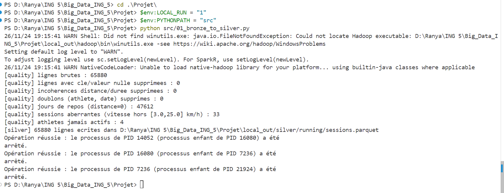
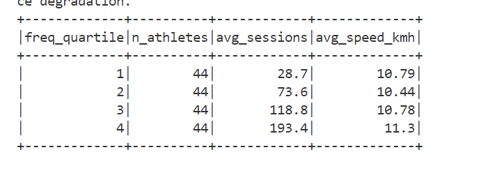
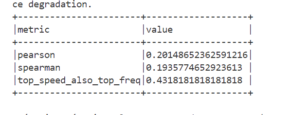
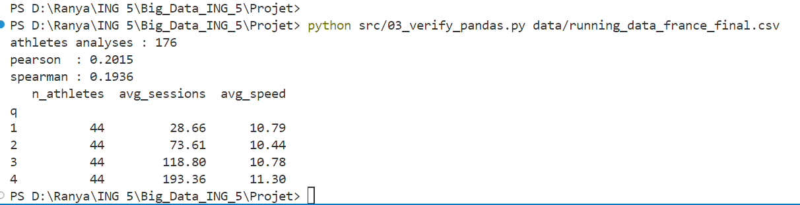
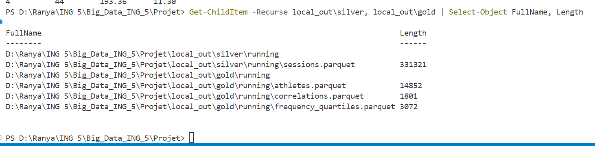

# Fréquence des sessions et vitesse de course : les plus rapides sont-ils les plus assidus ?

## Auteurs
- NOM1, Prénom1 — `<git username>`
- NOM2, Prénom2 — `<git username>`
- Groupe : `<Gr-xx>`

## Prérequis
- Service Onyxia **vscode-pyspark** (Spark 3.5, Python 3.x) avec accès S3 : variables `LAB_BUCKET_NAME`, `AWS_S3_ENDPOINT`, `AWS_ACCESS_KEY_ID`, `AWS_SECRET_ACCESS_KEY`, `AWS_SESSION_TOKEN` (injectées par Onyxia), AWS CLI.
- Vérification : `pandas`, `pyarrow` (`pip install pandas pyarrow`).
- Test local sans Onyxia : Java 8/11/17 et `pip install pyspark==3.5.3 pandas pyarrow`.

## Dataset
| | |
|---|---|
| Nom | `running_data_france_final.csv` — sessions de course d'athlètes français en 2020 |
| URL | `<à compléter : lien Kaggle d'origine>` |
| Licence | `<à compléter>` |
| Date de téléchargement | `<à compléter>` |
| Taille | 4,48 Mo (65 880 lignes, 9 colonnes, 180 athlètes × 366 jours) |

Le fichier d'origine a été **réduit** pour respecter la contrainte de 1 à 5 Mo du sujet : `<à compléter : méthode exacte, par ex. sous-échantillon de N athlètes>`.

## Problématique
Les coureurs les plus rapides sont-ils nécessairement les plus assidus ? Nous mesurons, par athlète, le nombre de sessions sur l'année et la vitesse moyenne (km totaux / heures totales), puis la corrélation (Pearson, Spearman) et la vitesse par quartile de fréquence.

## Chemins S3 (`$LAB_BUCKET_NAME`)
| Couche | Chemin |
|---|---|
| Brut (bronze) | `s3://<bucket>/bronze/running/running_data_france_final.csv` |
| Nettoyé (silver) | `s3://<bucket>/silver/running/sessions.parquet` |
| Final (gold) | `s3://<bucket>/gold/running/{athletes,frequency_quartiles,correlations}.parquet` |

## Reproduction
```bash
git clone <url-du-repo> && cd <repo>/Projet
pip install pandas pyarrow

# 1. Dépôt du brut sur S3 (bronze)
sh src/00_upload_raw.sh

# 2. Bronze -> Silver (nettoyage, affiche les compteurs de qualité)
PYTHONPATH=src python src/01_bronze_to_silver.py

# 3. Silver -> Gold (agrégats par athlète, quartiles, corrélations)
PYTHONPATH=src python src/02_silver_to_gold.py

# 4. Vérification indépendante (pandas, depuis le CSV brut, sans Spark)
python src/03_verify_pandas.py data/running_data_france_final.csv
```
- **Relance** : chaque étape écrase sa sortie (`overwrite`), donc idempotente ; relancer à partir de l'étape en échec.
- **Test local** (sans S3) : `export LOCAL_RUN=1` avant les étapes 2 et 3 ; sorties dans `local_out/`.
- **Résultat attendu** : 176 athlètes actifs, Pearson ≈ 0,20, Spearman ≈ 0,19, vitesse moyenne par quartile de fréquence 10,79 / 10,44 / 10,78 / 11,30 km/h. L'étape 4 doit donner les mêmes valeurs.
- Preuves d'exécution : `evidence/` (captures numérotées avec identifiant Onyxia et date).


commande : 
```bash
$env:LOCAL_RUN = "1"
$env:PYTHONPATH = "src"
python src/01_bronze_to_silver.py

```



```bash
python src/02_silver_to_gold.py
```



```bash
python src/03_verify_pandas.py data/running_data_france_final.csv
```


```bash
Get-ChildItem -Recurse local_out\silver, local_out\gold | Select-Object FullName, Length
```



CODE A LANCER SUR ONYXIA
```bash
sh src/00_upload_raw.sh
PYTHONPATH=src python src/01_bronze_to_silver.py
PYTHONPATH=src python src/02_silver_to_gold.py
python src/03_verify_pandas.py data/running_data_france_final.csv
aws s3 --profile default ls "s3://$LAB_BUCKET_NAME/" --recursive
```
